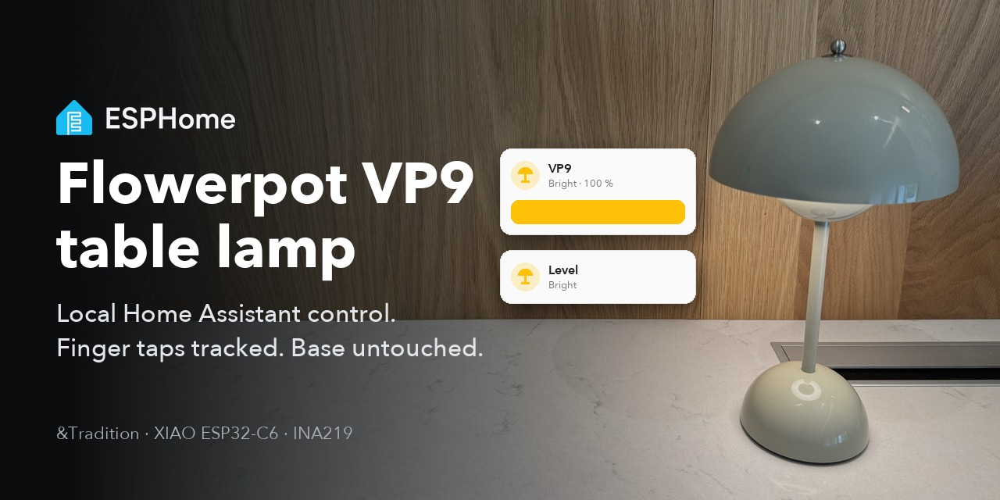
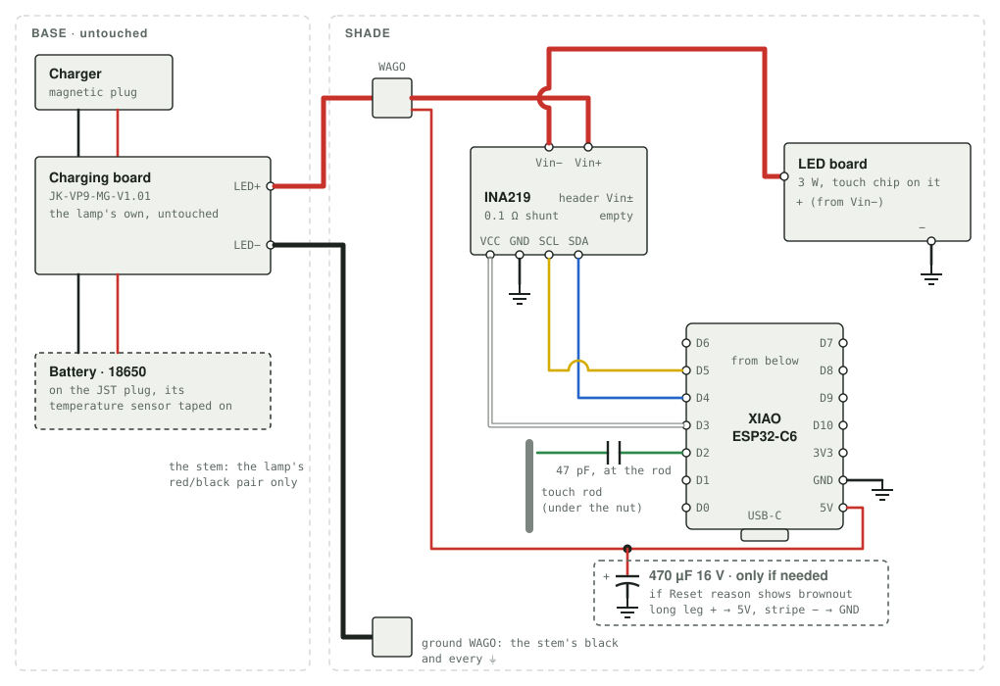
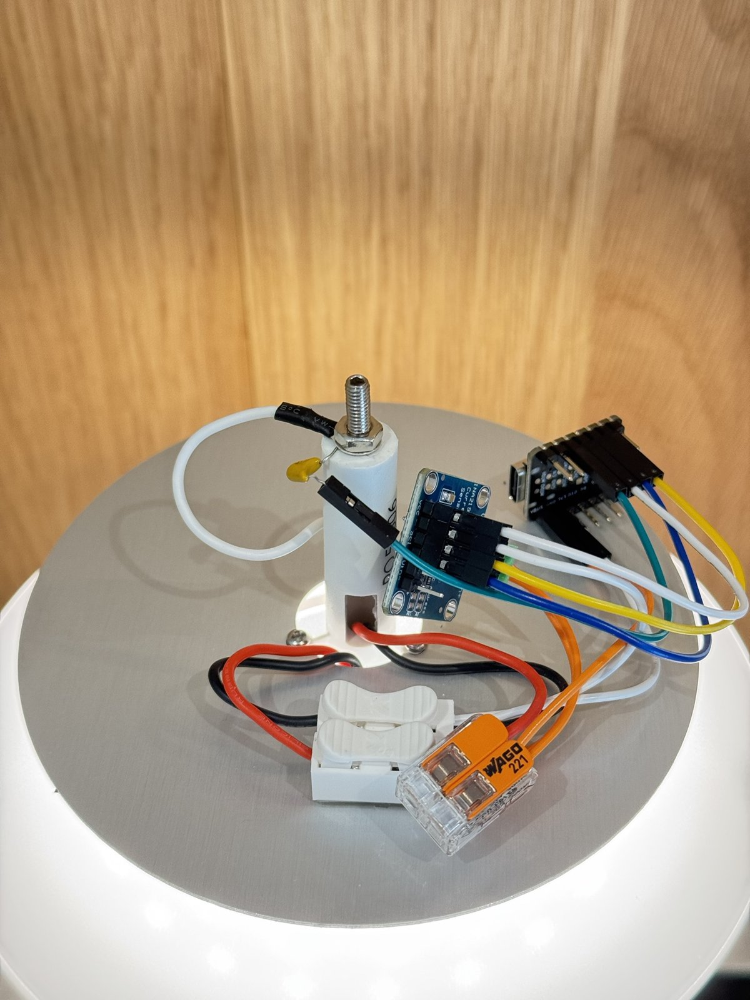
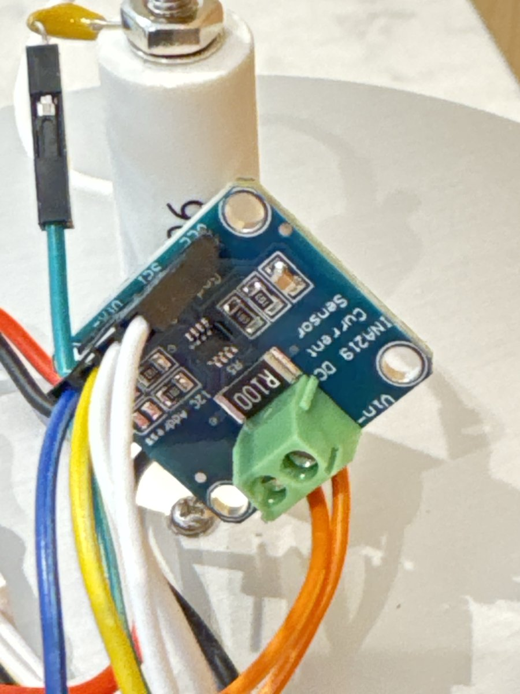
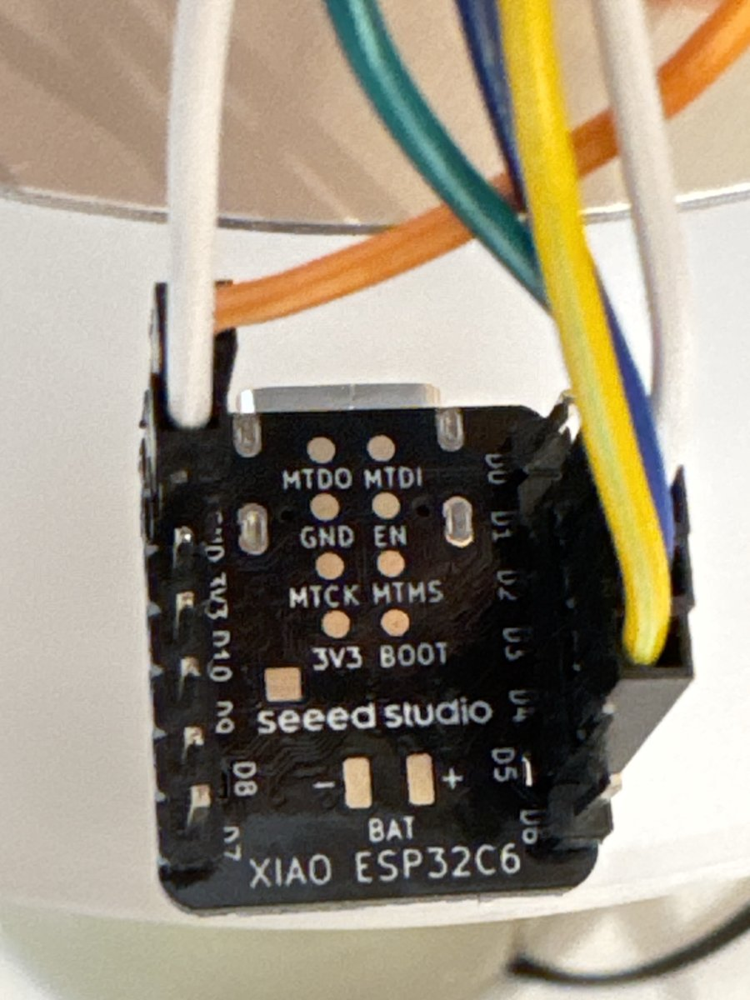

# ESPHome for the &Tradition Flowerpot VP9



Local [Home Assistant](https://www.home-assistant.io/) control for the **&Tradition Flowerpot VP9**, the
cordless table lamp by Verner Panton. The VP9 has no smart features: a battery in the base, a 3 W LED in the
shade, and a touch sensor on the metal rod at the top that steps it **brightest → middle → dimmest → off**. A
smart plug cannot switch it, because it runs from its own battery.

This adds a small [ESPHome](https://esphome.io/) board inside the shade. It taps the lamp electrically, the
same way a finger does, and reads which step the lamp is on from the LED's current, so Home Assistant always
knows the real state, including after someone taps it by hand. Nothing in the base is changed and nothing
new goes up the stem.

**What you get in Home Assistant:**

- a light: on, off, and dimming to the lamp's three steps (and from there Apple Home and Siri, through
  Home Assistant's HomeKit Bridge)
- a **Level** select: Off, Dim, Medium, Bright
- the LED current and the battery voltage
- the board's battery protection: it sleeps when the battery runs low, so it can never drain it

**Status:** proven on one lamp: finger taps are tracked, Home Assistant switches and dims it, all four
steps read correctly, and the low-battery sleep and wake work.

## Keep it on its charger

**Recommended: leave the lamp on its charger, always. The battery is optional.** The lamp runs from the
charger with no cell fitted at all, and with this board inside that is the safe way to use it.

The risk without a charger: the XIAO draws power from the lamp's battery all the time. Its low-battery
sleep slows that to a trickle, but nothing can stop it completely. **A lamp left off the charger for weeks
can run its cell flat, and a lithium cell run flat is ruined.** If you want it cordless now and then, put it
back on the charger within a few days.

## Will it work on mine?

Probably, if your VP9 looks like this inside:

- **Base:** an 18650 cell on a 2-pin JST plug, and a charging board marked `JK-VP9-MG-V1.01` with a magnetic
  charging connector underneath. Its `LED+`/`LED-` pads send a red/black pair up the stem.
- **Shade:** an LED board marked `LED MAX 3W 4.2V`, fed on the red/black pair through a lever connector. Its
  `TOUCH` wire is clamped under the nut of the threaded rod at the top. That rod is the touch sensor.

A different board revision may behave differently. If you try it, please report your board markings and
what worked, as an issue here.

## What you need

| Part | Why | Notes |
| --- | --- | --- |
| [Seeed Studio XIAO ESP32-C6](https://wiki.seeedstudio.com/xiao_esp32c6_getting_started/) | Runs ESPHome, on Wi-Fi | Its own ceramic antenna reaches about -68 dBm inside the closed shade |
| INA219 current sensor module | Reads the LED current, which tells the step, and the battery voltage | The common purple "CJMCU-219" board with a 0.1 Ω shunt, address `0x40` |
| 47 pF ceramic capacitor | Couples the XIAO to the touch rod | Marked `470` |
| 2 lever connectors (WAGO 221 or similar) | One for the 5 V side, one for ground | |
| 28 AWG silicone wire, or Dupont jumper wires | Thin enough for the shade | Red, black, white, blue, yellow and green keep it readable. Jumpers need no soldering at the XIAO and INA219 headers, but push each fully on: a loose one stops the INA219 answering, or the touch working |
| 470 µF 16 V electrolytic capacitor | Only if the XIAO restarts when the LED comes on | See [Troubleshooting](#troubleshooting) |
| Heat-shrink tubing | Only for soldered splices | Not needed with jumper wires and lever connectors: there is no bare joint |

**Tools:** a soldering iron, a multimeter, a USB-C cable for the first flash.

**Software:** everything runs through [uv](https://docs.astral.sh/uv/getting-started/installation/):
`uvx esphome@2026.9.1` is ESPHome, pinned to the version this config is proven on.

## How it works

### The touch sensor

The lamp's touch chip watches the capacitance of the rod. Measured on this lamp:

- **A tap is a step of a few tens of pF onto the rod.** A bare, floating wire touched onto the rod with a
  chopstick, with no body anywhere near, triggers it every time.
- **Shorting the rod to ground is not a tap.** Holding it at 0 V does nothing.
- **Anything left on the rod blinds it.** A 20 cm wire triggers it once, then the chip re-tunes and barely
  answers a finger until the wire comes off. After anything is touched at the rod, it can ignore taps for a
  minute while it settles.

### The fake finger

So the XIAO taps through a small capacitor: **rod → 47 pF → pin D2**. D2 is set up open-drain. At rest it
lets go, the capacitor floats, and the rod sees almost nothing, so a finger still works. For a tap it pulls
D2 to ground for 150 ms, which adds the capacitor to the rod: a finger-sized step. To reach a step, the
firmware taps round the cycle one step at a time: it waits for the LED current to show each tap landed
(about 0.3 s a tap) before the next, and taps again if one did not. Home Assistant sees the new step as
soon as the lamp reaches it - about half a second for on, a little over a second for brightest to off.

### Knowing the step

An **INA219** sits in the LED's red power wire. Each step draws a clearly different current, so the reading
names the step whoever changed it. The current follows the supply: one lamp's brightest draws 0.67 A on its
charger with no battery, but 0.43 A on a 3.7 V battery, so calibrate on both.
It is read every 100 ms, and a step counts once two readings in a row agree. The INA219 also reads the
battery voltage.

A light sensor was tried first and failed: daylight through the shade read as "on".

### Protecting the battery

The XIAO runs from the lamp's own battery, so left alone it would drain it flat. Below **3.5 V** it goes
into deep sleep (about 0.02 mA, with the INA219 switched off too). It wakes on a timer, reads the battery
for about two seconds with Wi-Fi still off, and goes straight back to sleep unless the battery has reached
**3.7 V**, meaning the lamp is charging. The lower the battery, the longer it sleeps between checks:

| Battery | Checks every |
| --- | --- |
| below 3.5 V | 30 minutes |
| below 3.3 V | 4 hours |
| below 3.2 V | 1 day |

So after a deep discharge it can take up to a day on the charger before it is back in Home Assistant. A
power-on (unplugging and replugging the charger, with no battery fitted) always brings it straight back,
with a minute's window for a firmware update. The lamp's own touch keeps working the whole time. A
**Stay awake** switch blocks the sleep while you update the firmware.

## Build

### 1. Flash on the bench first

Do the one USB flash **before** the XIAO is wired to the lamp. Once it is in the lamp, update it over Wi-Fi
only (see [Rules](#rules)).

1. Copy `secrets.example.yaml` to `secrets.yaml` and fill it in. The XIAO only does 2.4 GHz Wi-Fi.
2. Copy `vp9-example.yaml` to `vp9-<name>.yaml` and set the `name`. Keep the cut-offs for now. It includes
   your copy of `vp9-common.yaml`; it can pull a pinned release from GitHub instead (see the comment in it).
3. Plug the XIAO in over USB and run:

   ```sh
   uvx esphome@2026.9.1 run vp9-<name>.yaml
   ```

4. Home Assistant finds the new device. Adopt it with the `api_key` from `secrets.yaml`.

### 2. Wire it in the shade





*One finished build, shade open. The yellow 47 pF capacitor has one leg under the rod's nut and the tap wire
plugged onto the other; the INA219 and the XIAO are on jumper wires; the lever connectors join the lamp's
red and black. The wire colours here differ from the diagram: ground is white, and the 5 V side orange.*

Unplug the charger and the battery first. **To open the shade, unscrew the silver ball on top of it.** That ball is
also the touch sensor: it screws onto the threaded rod inside. Screw it back on firmly when you close the lamp, or
touch becomes unreliable.

| Wire | From → to |
| --- | --- |
| LED feed (red) | Cut the lamp's red at its lever connector. The stem end goes into a lever connector, which feeds the INA219's **Vin+** (right screw terminal, chip side up). **Vin−** goes on to the LED board's +. |
| 5 V (red) | The same lever connector → XIAO **5V**, or its **`BAT+`** pad (see below). It takes power before the INA219, so the INA219 measures only the LED. |
| Ground (black) | Ground lever connector: the stem's black, the LED board's −, XIAO **GND**, INA219 **GND**. |
| INA219 power (white) | XIAO **D3** → INA219 **VCC**. A pin rather than 3V3, so the INA219 switches off when the XIAO sleeps. |
| SDA (blue) | XIAO **D4** → INA219 **SDA** |
| SCL (yellow) | XIAO **D5** → INA219 **SCL** |
| Tap (green) | XIAO **D2** → 47 pF → the rod. Clamp one leg of the capacitor under the rod's nut, and run the long wire on the XIAO's side of it, never between the capacitor and the rod. Route it away from the rod. |

 

*Left: the INA219, the lamp's feed (orange in this build) in the green screw terminal across the `R100`
(0.1 Ω) shunt, and only the jumpers on the header. Right: the XIAO from below, the side the diagram shows:
D0 to D6 down one edge, GND, 3V3 and D10 to D7 down the other.*

- **The INA219's header has its own Vin+ and Vin− pins.** They are the same as the screw terminals. Leave
  them empty.
- **Check the INA219 before powering it**, especially after soldering its header. With the meter on Ω,
  SDA to VCC and SCL to VCC should each read about 10 kΩ (the board's own pull-up resistors), and GND should
  beep through to the XIAO's GND. A reading of "1" or OL is a bad solder joint.
- **Insulate any soldered splice** (heat-shrink). Jumper plugs and lever connectors need nothing.

#### Optional: feed the XIAO on `BAT+` instead of `5V`

The XIAO has two battery pads on its underside, **`BAT+`** and **`BAT−`**. Feeding it on `BAT+` instead
of the `5V` pin helps when the lamp runs from its battery. `5V` passes through a Schottky diode that drops
about 0.35 V and a 100 kΩ resistor that draws about 40 µA, twice the chip's own deep sleep. `BAT+` passes
through a transistor switch with almost no drop. So on `BAT+` the board keeps running further down the
battery and drains it less while asleep. On the charger alone, without a battery, it makes no difference.

- Solder a short red wire to the `BAT+` pad and put its other end into the red lever connector in place
  of the wire to `5V`. Leave `5V` and `BAT−` empty: `GND` is the same ground.
- Insulate the joint so it cannot touch the metal shield next to it. Before fitting: the wire beeps through
  to `BAT+` and does **not** beep to `GND`.
- Strip about 11 mm for the lever connector and push it fully in, so the lever clamps copper, not
  insulation. A wire that only looks seated leaves the XIAO dead in the lamp. To find one: with the lamp
  on, `BAT+` to `GND` should read the battery's ~4 V, the same as the INA219's Vin+.
- On `BAT+`, plugging USB into the XIAO would charge the lamp's battery from the XIAO's own charger: even
  more reason never to plug USB in while it is wired to the lamp.

Proven on one lamp running from its battery. **Not yet proven:** the sleep-current saving, which has not
been measured.

### 3. Power up and calibrate

1. Put the lamp on its charger. It runs without the battery, which makes a safe first test.
2. In Home Assistant, check that **LED current** and **Battery voltage** show values.
3. Tap through all four steps by hand, about 10 seconds on each, and note **LED current** at each.
4. If you use a battery, plug it in and note the four currents again: they read lower on a battery than
   on the charger alone.
5. Set `dim_from`, `mid_from` and `bright_from` in your `vp9-<name>.yaml` about halfway between the steps,
   between the ranges if you have two readings per step, and update over Wi-Fi:

   ```sh
   uvx esphome@2026.9.1 run vp9-<name>.yaml --device <the XIAO's IP address>
   ```

6. Tap through again and check that **Level** follows. Then try switching and dimming from Home Assistant.

Using a battery at all is optional (see [Keep it on its charger](#keep-it-on-its-charger)).

## In Home Assistant

| Entity | What it is |
| --- | --- |
| Light | On, off and brightness. Below 50 % is dimmest, below 83 % middle, above that brightest. From off, any "on" goes to brightest first. |
| Level | Off, Dim, Medium, Bright, for when a slider is too vague |
| LED current | The reading the step comes from, every 10 s. Use it to calibrate. |
| Battery voltage | The cell, averaged over 10 s. On the charger with no cell, the charger's supply. |
| Stay awake | Blocks the low-battery sleep. Turn it on only while updating the firmware. |
| Reset reason | Why the board last started. `brownout` means its supply dipped. |
| Restart, Uptime, Wi-Fi signal, Chip temperature, IP address, MAC address | Diagnostics |

## Troubleshooting

Almost every fault seen while building this was a connection, not a part. Start here whatever the symptom:

1. **Reseat every wire.** Push each jumper plug fully on, and check each lever connector is closed on bare
   copper, not insulation.
2. **Check it against the [wiring table](#2-wire-it-in-the-shade),** pin by pin. Go by the pin labels, not
   the wire colours.
3. **Meter it, with the charger unplugged.** On beep (continuity), test each wire end to end, from the pin at
   one end to the pin at the other. On Ω, check the INA219: SDA to VCC and SCL to VCC about 10 kΩ each.
4. **Restart clean.** Plug the charger back in without touching the lamp and wait a minute: the touch chip
   sets itself up at power-on, and ignores taps for a while after anything at the rod has been touched.

If it still misbehaves:

| Problem | What to check |
| --- | --- |
| The lamp ignores a finger, only on one charging cable | The magnetic charging cable. A faulty one can look perfect, still charge a little, and stop the lamp running without a battery. |
| The INA219 is not found (`Communication failed` in the log) | A header pin not soldered to the board: SDA–VCC or SCL–VCC reads "1" or OL instead of about 10 kΩ. Reflow that joint. |
| The XIAO restarts when the LED comes on | **Reset reason** shows `brownout`. Fit the 470 µF capacitor across the XIAO's 5V (+, the long leg) and GND (−, the striped side), right at its pins. A worn battery sags more and makes this likelier. |
| Level changes on its own | A cut-off is too close to a step. Re-read **LED current** at each step and move the cut-offs. |

## Rules

- **Never plug USB into the XIAO while it is wired to the lamp.** The USB 5 V would back-feed the lamp's
  battery. Update the firmware over Wi-Fi.
- **Leave Stay awake off.** Turned on, the XIAO never sleeps and drains the battery.
- **No bare metal loose in the shade.** A soldered splice gets heat-shrink, and a capacitor leg must touch only
  what it is meant to. A bare joint touching another is a short.

## Credits

- The [Home Assistant forum thread](https://community.home-assistant.io/t/zigbee-support-for-dumb-touch-controlled-table-lamp/975882)
  on touch-controlled table lamps, with photos of this lamp's board.
- [ESPHome](https://esphome.io/), and its `ina219` component.
- The ESPHome logo in the banner is ESPHome's own, from [esphome/esphome.io](https://github.com/esphome/esphome.io). The photos are of the lamp this was built on.

## License

MIT, for the files in this repo.
